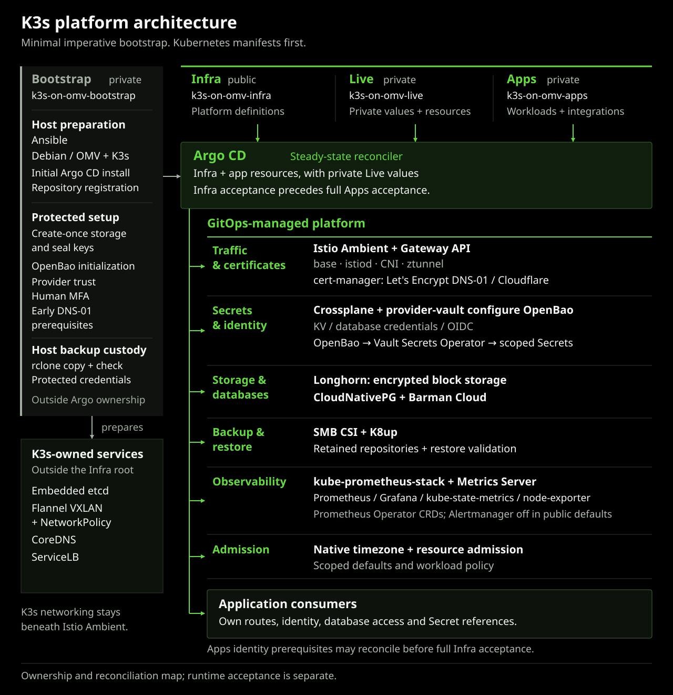
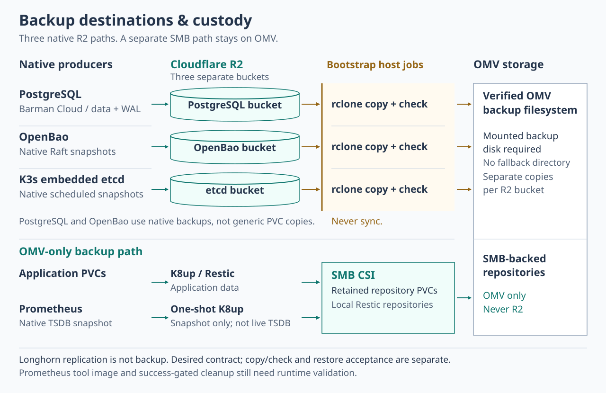

# 🏠 K3s on OpenMediaVault — GitOps infrastructure

[](https://github.com/dmuiX/k3s-on-omv-infra/actions/workflows/bootstrap-order.yml)

The public infrastructure layer of my **K3s homelab on Debian and OpenMediaVault**. Argo CD manages a platform built around Istio Ambient, OpenBao, Crossplane, Longhorn, CloudNativePG and Prometheus/Grafana.

The goal is **as little imperative bootstrap as necessary, and as much platform state as possible in Kubernetes manifests**. Argo CD and Kubernetes controllers should own recurring configuration instead of an expanding collection of Ansible tasks and custom scripts.

Use supported upstream chart values first, then native Kubernetes resources and existing operator CRDs. Crossplane represents supported OpenBao configuration as manifests; custom helpers are reserved for demonstrated API gaps. The original specification and architecture decisions explain the [native-first design, alternatives and accepted trade-offs](docs/architecture.md).

> This repository is developed alongside **three private repositories** for bootstrap automation, site configuration and applications. It publishes the infrastructure definitions and public test fixtures, not a standalone installer or the complete live configuration.

[🧱 Architecture](#-architecture) · [🧭 Design decisions](docs/architecture.md) · [📦 Components](#-platform-components) · [📂 Repository layout](#-repository-layout) · [🧪 Validation](#-validation) · [📚 Operational documentation](#-operational-documentation)

## 🔗 Repository boundaries

| Repository | Visibility | Responsibility |
| --- | --- | --- |
| **`k3s-on-omv-infra`** — this repository | Public | Argo CD Applications, public Helm values, platform resources, integration charts and contract tests |
| `k3s-on-omv-bootstrap` | Private | Ansible-based host/K3s preparation, initial Argo CD installation, repository registration, create-once encryption material and protected OpenBao initialization |
| `k3s-on-omv-live` | Private | Site-specific Helm values, endpoints, routes and resources referenced by Infra and Apps |
| `k3s-on-omv-apps` | Private | Application definitions and their database, identity and credential integrations |

Bootstrap prepares and accepts the base cluster, seeds Argo CD and performs protected initialization as the infrastructure becomes ready: encryption-key custody, OpenBao initialization/provider trust, attended identity/MFA setup and shared backup credentials. Argo CD owns steady-state reconciliation. **Full Apps acceptance waits for Infra acceptance; Apps-owned identity prerequisites can be reconciled earlier for the protected ceremony.** Host preparation, platform controllers and application resources have separate owners.

Private repository names are shown for context; their inventories, credentials and site configuration are not reproduced here.

## 🧱 Architecture

The diagram shows repository ownership and the main platform components, not a statement that every runtime acceptance gate has passed.

[](docs/images/platform-architecture.svg)

The [architecture and decision record](docs/architecture.md) explains why these mechanisms were chosen, where imperative work remains and how the current implementation differs from the original specification. OpenBao provides KV, database credentials and OIDC; **it does not operate a PKI**.

Istio is the sole Ambient/Gateway controller; packaged Traefik is disabled. Its CNI integrates the mesh with the **K3s-owned Flannel network** rather than replacing the base CNI. CoreDNS and ServiceLB remain K3s-owned. The [Metrics Server handoff](docs/metrics-server-gitops.md) moves only resource metrics into Infra; existing clusters require an attended transition before activation. Host/workload logging is separate infrastructure and is not configured by this repository.

### Backup paths

[](docs/images/backup-architecture.svg)

**Longhorn replication is not a backup.** PostgreSQL and OpenBao use their own backup paths, not generic K8up PVC copies. Prometheus uses native snapshot-first backup, never a copy of its live TSDB. The Prometheus tool image and success-gated cleanup path still have unresolved deployment gates; the diagram describes the defined contract. See the [backup contract](docs/backup-contract.md) for destination, retention and restore requirements.

## 📦 Platform components

| Area | Components and source | Role |
| --- | --- | --- |
| Reconciliation | [Argo CD](01-bootstrap/argocd-config/app.yml), [Infra root](infra.yml) | Initial bootstrap hands off to chart-based self-management; sync waves order dependencies |
| Networking | [Istio](01-bootstrap/istio/app.yml), [Gateway configuration](01-bootstrap/istio-gateway/app.yml) | Ambient mesh and native Gateway API deployment; private listeners/routes come from Live |
| Certificates | [cert-manager](02-controllers/cert-manager/app.yml), [issuers](00-letsencrypt-dns01-issuer/app.yml), [DNS credentials](06-platform/letsencrypt-dns01-credentials/app.yml) | ACME DNS-01 certificate integration with Cloudflare |
| Secrets and identity | [OpenBao](04-openbao/app.yml), [Crossplane](02-controllers/crossplane/app.yml), [provider-vault](03-provider-vault/app.yml), [VSO](02-controllers/vault-secrets-operator/app.yml) | Declarative KV/auth/database/OIDC configuration and scoped secret delivery; no OpenBao PKI |
| Block storage | [Longhorn](02-controllers/longhorn/app.yml), [late configuration](06-platform/longhorn-config/app.yml) | Encrypted storage classes and consumer-owned UI/OIDC integration; proxy compatibility remains gated |
| Databases | [CloudNativePG](02-controllers/cloudnative-pg/app.yml), [Barman Cloud](02-controllers/barman-cloud/app.yml), [database cluster](07-k3s-postgres/app.yml) | PostgreSQL reconciliation, replication, object-store backups and bounded retention support |
| Backup and restore | [K8up](02-controllers/k8up/app.yml), [SMB CSI](02-controllers/csi-driver-smb/app.yml), [OpenBao snapshots](06-platform/openbao-backups/app.yml), [validation](08-backup-validation/app.yml) | Separate backup transports and restore-validation contracts; actual recovery requires runtime evidence |
| Resource metrics | [Metrics Server](01-bootstrap/metrics-server/app.yml) | Official chart on standard nodes; resource Metrics API for `kubectl top` and HPA, before Istiod |
| Observability | [Prometheus Operator CRDs](01-bootstrap/prometheus-operator-crds/app.yml), [kube-prometheus-stack](09-kube-prometheus-stack/app.yml) | Prometheus, Grafana, exporters and platform alerts; Alertmanager configuration exists, but public defaults set its replicas to zero |
| Admission defaults | [Timezone defaults](01-bootstrap/timezone-defaults/app.yml), [resource defaults](01-bootstrap/resource-defaults/app.yml) | Native Kubernetes policies with isolated admission tests |
| Application integration | [Integration charts](charts/), [credential custody](adapters/credential-custody/) | Reusable routing, network-policy, OIDC and PostgreSQL-consumer resources without moving application ownership into Infra |

Chart versions and public overrides live in the Application manifests rather than a second version table in this README. Helm Applications use inline `helm.valuesObject` plus private `$live` value files. Controller Applications own controllers/CRDs; consumer resources stay with their applications.

## 📂 Repository layout

```text
infra.yml                         Argo CD Infra root
00-letsencrypt-dns01-issuer/       Early issuer application
01-bootstrap/                     Argo CD, resource metrics, Istio, CRDs and native defaults
02-controllers/                   Platform operators and storage controllers
03-provider-vault/                Provider package and explicit API allowlist
04-openbao/                       OpenBao workload and access boundaries
05-provider-vault-connection/      Provider authentication contract
06-platform/                     Shared credentials and late platform integration
07-k3s-postgres/                   Concrete PostgreSQL cluster
08-backup-validation/              Restore-validation resources
09-kube-prometheus-stack/          Monitoring, alerts and snapshot contracts
charts/                           Consumer integration charts
adapters/                         Bounded helpers for demonstrated API gaps
tests/                            Public fixtures, render and workload contracts
docs/                             Architecture decisions, migrations and runbooks
```

Numbered directories make the phases readable; Application `sync-wave` annotations remain authoritative. Automatic pruning is disabled, so removing a manifest from Git is **not** a resource-retirement procedure.

## 🧪 Validation

The [Repository workload contracts workflow](.github/workflows/bootstrap-order.yml) runs on pull requests and pushes to `main`:

- Downloads exact tools and official chart archives with SHA-256 verification.
- Renders real Helm/Kustomize inputs with **synthetic public values**, without private checkouts or a production kubeconfig.
- Checks workload, credential-ownership, network-policy, chart and Argo Application-health contracts.
- Exercises native timezone and scoped resource admission against an isolated, agentless K3s API.
- Runs formatting, Ruff and strict mypy checks for the maintained CI helpers.

See [tests/README.md](tests/README.md) for commands, prerequisites and the exact coverage boundary. The broader integration runner requires private Bootstrap/Live/Apps siblings and is separate from public CI.

**A green public build is not deployment or recovery acceptance.** Private integration, live connectivity, storage behavior, credential rotation, backup restores and the [compatibility gate](COMPATIBILITY.md) remain separate checks. Unresolved `REQUIRED_*` inputs intentionally block deployment. There is no standalone `kubectl apply` quickstart for this four-repository platform.

## 📚 Operational documentation

- [Architecture, specification and design decisions](docs/architecture.md) — native-first priorities, accepted trade-offs, ownership and acceptance stages.
- [Platform contracts and migration notes](docs/platform-contracts.md) — implementation detail retained from the original README.
- [Infra root and private-value migration](docs/infra-root-migration.md).
- [Service ownership and credential custody](docs/service-credentials.md).
- [Mesh chart evidence and compatibility](docs/mesh-chart-evidence.md).
- [Backup destinations and recovery gates](docs/backup-contract.md).
- [PostgreSQL WAL recovery](docs/postgresql-wal-recovery.md).
- [Prometheus snapshot-first backup runbook](docs/prometheus-tsdb-backup-runbook.md).
- [Small-node placement](docs/small-node-placement.md) and [resource request profile](docs/resource-request-profile.md).
- [Compatibility and remaining runtime gates](COMPATIBILITY.md).
