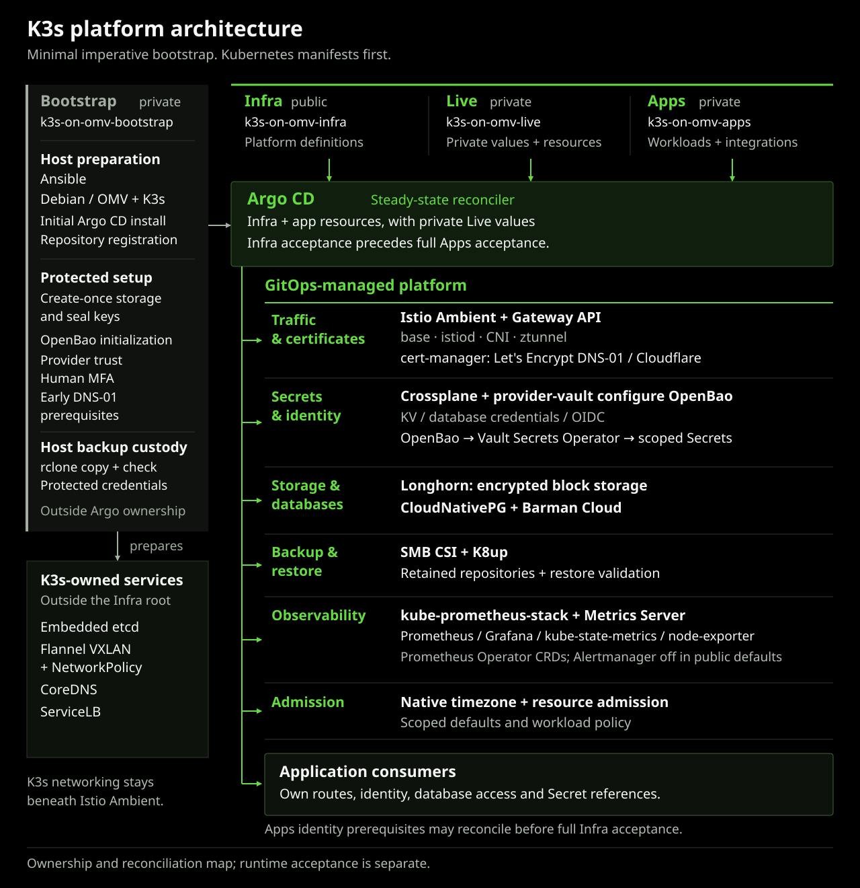
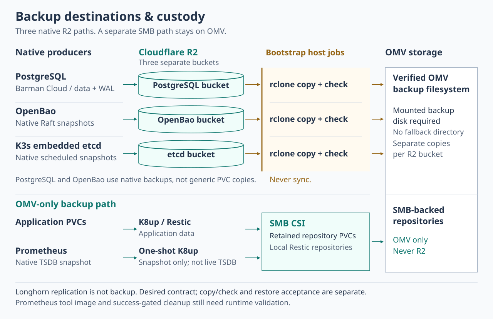

# Platform architecture and design decisions

**As little imperative bootstrap as necessary; as much platform state as possible in Kubernetes manifests.**

This is the public, implementation-linked summary of the original v6.5 platform specification and its four accepted architecture decisions. It preserves the design rationale without publishing private inventories, site configuration, credentials or operator conversations. Later implementation changes are called out rather than presented as if the original specification were unchanged.

The diagrams explain ownership and backup paths. They are not evidence that a deployment, failover or restore has passed acceptance.

[Design priorities](#design-priorities) · [Ownership](#repository-and-resource-ownership) · [Secrets and identity](#secrets-and-identity) · [Networking](#network-and-certificate-boundaries) · [Data and recovery](#data-storage-and-recovery) · [Specification versus implementation](#specification-versus-current-implementation)

## Design priorities

The aim is a small, understandable platform, not the largest possible toolset. Prefer fewer permanent components, manifests, custom code paths and operator steps. Implement each capability at the first supported level below; moving further down requires evidence that the earlier levels do not satisfy the requirement.

| Preference | Mechanism | Why |
| --- | --- | --- |
| 1 | Supported values of a maintained upstream Helm chart, reconciled by Argo CD | Reuse the component's own configuration instead of maintaining parallel resources or patches |
| 2 | Native Kubernetes resources or existing operator CRDs | Keep desired state declarative and let the responsible controller manage its lifecycle |
| 3 | Crossplane managed resources | Express supported state outside the Kubernetes API, such as OpenBao server configuration, as reconciled Kubernetes resources |
| 4 | A small authored resource, integration chart or bounded, tested adapter for a demonstrated gap | Add only the behavior that the native interfaces cannot provide |
| 5 | Ansible for hosts/K3s, create-once bootstrap, protected ceremonies and recovery | Keep imperative work outside steady-state workload management |

GitOps is the normal operating path throughout. Use Kustomize only for an actual transformation, not as an extra file-list layer. Do not commit rendered upstream charts or introduce another controller, custom application CRD or Crossplane Composition merely to wrap a small set of supported resources.

A Job or ConfigMap can declare how custom code runs, but that code is still a maintenance obligation. Its placement in Kubernetes does not remove the requirement to justify the adapter. The current integration charts and helpers are bounded exceptions, not a goal to expand into a framework.

## Architecture at a glance

### Repository and resource ownership

| Repository | Owns | Boundary |
| --- | --- | --- |
| Bootstrap — private | Host inventory and preparation, K3s, initial Argo CD setup, create-once keys, protected initialization and recovery custody | Does not become a second steady-state workload manager |
| Infra — public | Platform Applications, pinned chart references, public values, controllers, policies, resources and tests | Contains no private inventory, resolved credentials or site-specific endpoints |
| Live — private | Consumed site-specific Helm values and explicitly required private resources | Supplies configuration; does not select applications or become another root |
| Apps — private | Workloads and their routes, OIDC clients, secret-consumption resources and database/backup integrations | Does not own shared controllers or infrastructure CRDs |

Controller Applications own controllers and CRDs. Consumers own their concrete custom resources and integrations: an application owns its route and database access, not the shared Gateway or database operator. Operators own the runtime resources they generate.

The rule is **one continuous owner for each field**. Avoid two systems repeatedly writing the same configuration. A documented field-scoped handoff is possible where an API requires it; see the Barman exception below. An app-specific credential must not become another unrelated item in a shared OpenBao configuration Application.

Resource metrics have an explicit [K3s-to-GitOps handoff](metrics-server-gitops.md):
Bootstrap disables only the packaged duplicate; Infra owns the official Metrics
Server chart on standard nodes. CoreDNS, Flannel and ServiceLB remain K3s-owned.
Existing installations require attended retirement/adoption before activation;
the declared ownership diagram is not evidence that this transition has run.

See [service ownership and credential custody](service-credentials.md), [Infra root/value-file handoff](infra-root-migration.md), and the [consumer integration charts](../charts/).

## Bootstrap, reconciliation and acceptance

### A thin bootstrap with explicit state

The private launcher classifies the complete target cohort read-only as `CLEAN`, `BASE_ACCEPTED` or `AMBIGUOUS`:

- A clean base can be built and accepted before GitOps proceeds.
- An accepted base keeps its installation and resumes from observed GitOps/OpenBao checkpoints. Managed host configuration can still converge; resume does not mean that every host setting is frozen.
- Ambiguous, foreign, unreachable or inconsistent state stops rather than being silently adopted, overwritten or reset.

Automatic cleanup is a narrow pre-acceptance exception: it requires a handled build failure, an unchanged frozen inventory, the exact cohort and a valid run-bound receipt. An interrupt, unreachable host, failed GitOps operation or already accepted base does not authorize cluster deletion. A successful cleanup does not turn the failed build into a success.

Bootstrap owns the work that precedes the responsible controllers or requires protected operator participation: initial Argo installation, repository access, create-once encryption/seal material, OpenBao initialization and provider trust, and attended human/MFA setup. Root tokens are initialization/emergency material, not normal workload credentials. Recovery material must exist in independent protected custody before first use when recovery requires it outside the cluster.

### Handoff rather than parallel management

Argo CD takes over the same pinned chart/public values used for its initial installation; Helm and Argo are not competing release managers. Applications self-heal, but automatic pruning is disabled. Removing a file from Git is not an approved stateful-resource retirement, ownership transfer or disaster-recovery operation.

Sync waves order children within a root; they do not create a dependency between unrelated roots. The current bootstrap can activate Apps-owned identity prerequisites for a protected ceremony before the final platform gate. **Full Apps acceptance still follows Infra acceptance.**

### Staged acceptance

| Stage | Desired outcome |
| --- | --- |
| Cluster core | Accepted K3s/etcd base, networking, GitOps, certificates and encrypted storage |
| Secure platform | Mesh/gateway, OpenBao, declarative configuration and secret delivery |
| Data platform | PostgreSQL, native backups, retention and isolated restore validation |
| Operational platform | Monitoring, alert delivery, placement and capacity evidence |
| Application | End-to-end identity, routing, credentials, persistence and restart behavior |

These are acceptance stages, not a replacement for the actual Application sync-wave annotations. A later unfinished stage does not invalidate an independently accepted earlier one.

Keep three states distinct: **declared** means desired state exists in Git; **activated** means a root selects it for reconciliation; **operational** means end-to-end runtime acceptance passed. A present custom resource or a successful sync alone is not operational acceptance.

## Secrets and identity

### Decision 1: cluster-local OpenBao auto-unseal

**Choice:** OpenBao uses Raft storage and a create-once static seal key mounted from a Kubernetes Secret. This enables unattended restarts without requiring an external KMS or manual unseal on every restart.

**Accepted trade-off:** the seal key lives in the same cluster. This improves availability but is not an isolation boundary against complete cluster compromise. External recovery custody and verified recovery procedures remain essential; Kubernetes Secret encryption and encrypted volumes do not remove that limitation.

The OpenBao runtime must start without depending on its own VSO, Crossplane or PostgreSQL configuration. Initialization, provider trust and later declarative configuration are separate steps. See the [OpenBao Application](../04-openbao/app.yml).

### Decision 2: Crossplane for supported OpenBao server configuration

**Choice:** Crossplane/provider-vault represents supported mounts, policies, auth roles, database configuration and OIDC resources as Kubernetes manifests. Argo reconciles those resources; the provider reconciles OpenBao.

**Rationale:** VSO and ESO consume secrets; they do not replace a server-configuration controller. Terraform/OpenTofu would add protected state and another runner/lifecycle. The original decision requires an isolated comparison with a maintained Vault Config Operator **before provider-vault enters the deployable core**, covering OpenBao compatibility, static-role rotation, OIDC, ARM64, drift, resource cost, API surface and upgrade risk. Crossplane remains selected unless an alternative demonstrates a clear advantage; switching requires a reviewed specification and ownership update. This documents the required comparison, not a claim that it has already passed.

Bootstrap establishes the provider's trust root. The provider must not own its own trust policy/auth configuration, root/seal/recovery material or a PKI. Its activation policy is an explicit allowlist, not all APIs supplied by the package. Empty default activations prevent an additive default policy. Reducing an allowlist does not deactivate APIs already activated; retirement requires a separate reviewed cleanup.

The [activation-policy manifest](../03-provider-vault/resources/activation-policy.yaml) is authoritative for the current types. See [API/network ownership](api-network-ownership.md) and [the activation/migration contract](platform-contracts.md#crossplane-api-activation).

### Decision 3: VSO for Kubernetes secret consumption

**Choice:** Vault Secrets Operator is the sole consumption mechanism for the intended OpenBao-backed Kubernetes Secrets. It was selected for the required static-database-credential, refresh and rollout behavior; the exact pinned OpenBao/VSO combination still needs compatibility and runtime acceptance.

Server configuration, secret values and consumption are different responsibilities. A shared transport connection does not grant shared authorization: consumers retain namespace/ServiceAccount-bound authentication and narrow path access. Do not run ESO and VSO as competing owners of the same destination Secret.

Secret values stay in OpenBao or external custody, not Git. Native Kubernetes authentication and Secret references connect controllers and workloads without copying plaintext into desired state. See [VSO connections](vso-connection.md) and [required-value handling](vso-required-values.md).

## Network and certificate boundaries

### Decision 4: separate transport, certificate and backup trust

**Choice:** K3s keeps the base Flannel network and NetworkPolicy implementation. Istio supplies Ambient mTLS and the sole Gateway API controller; packaged Traefik is disabled. Use waypoints only for a demonstrated L7 requirement.

Publicly trusted Gateway certificates come from cert-manager/Let's Encrypt through DNS-01. Public certificate issuance does not imply internet-exposed services. Private endpoints and routing values remain in Live; consumers own their HTTPRoutes.

**OpenBao has no PKI role.** Its responsibilities here are KV, database credentials and OIDC identity. Internal workload transport uses Istio rather than a parallel OpenBao-issued client-certificate layer. A future private client PKI would be separately approved, external infrastructure, not CA keys and issuers added to this cluster.

Sensitive namespaces have targeted default-deny policies and the required Ambient transport controls. This is not a claim that every namespace uses the same policy or that a configured object-store endpoint alone enforces endpoint-only egress.

The current certificate-first sequence uses early credential seeding and explicit Certificates before the Gateway, replacing the original annotation/shim-only prerequisite model. See [certificate-first bootstrap](CERTIFICATE-FIRST-BOOTSTRAP.md) and [mesh compatibility evidence](mesh-chart-evidence.md).

## Data, storage and recovery

### Workload-specific redundancy

Use encrypted Longhorn storage with retained volumes, but choose redundancy at the appropriate layer:

- General platform storage uses replicated Longhorn volumes.
- PostgreSQL and monitoring use dedicated strict-local, single-storage-replica classes where application-level redundancy is the intended resilience mechanism.
- CNPG reconciles the database cluster and consumers' native Database resources; application login/rotation ownership belongs to OpenBao and the consumer's declarations, not a second CNPG role writer.
- Static database roles remain static even when consumed through a `VaultDynamicSecret` resource with `allowStaticCreds`. VSO refresh/reload behavior must match the application's actual reconnect behavior.

The checked-in [StorageClasses](../02-controllers/longhorn/resources/storageclasses.yaml), [database Cluster](../07-k3s-postgres/resources/cluster.yaml) and [consumer chart](../charts/postgres-consumer/) define current values. Do not copy original capacity, synchronous-durability or placement numbers into a new deployment without checking those sources.

### Native backups and independent custody

**Longhorn replication is not backup.** Each data system uses its supported recovery format:

- PostgreSQL: Barman base backups and continuous WAL archives for recovery/PITR.
- OpenBao: native Raft snapshots and verified external seal/recovery custody.
- etcd: native K3s snapshots and a recovery path that does not depend on OpenBao already running.
- Suitable application PVCs: K8up/Restic through retained SMB CSI repository PVCs, on OMV only. Reconstructible data is classified separately rather than backed up generically.
- Prometheus: create a native TSDB snapshot first, then back up that snapshot with one-shot K8up. Never copy the live TSDB; remove only that run's intermediate snapshot after verified backup/check success.

Native PostgreSQL, OpenBao and etcd backups use separate object-store buckets. Host-side systemd jobs use **`rclone copy` plus verification, never `sync`**, to preserve local OMV copies without propagating source deletion. An unavailable verified backup disk/share must stop the operation, not create a replacement directory on the root filesystem. K8up has no R2, NFS or hostPath fallback.

One R2 credential pair is shared across the three native backup categories to simplify custody. The accepted object-store blast radius spans those buckets even though Kubernetes roles are namespace/ServiceAccount-bound. Independent credentials or reissuance access must make recovery possible when both Kubernetes and OpenBao are unavailable.

Restore tests use isolated new targets and never overwrite production data. A successful Job or readable backup is not a restore demonstration. Native copy, snapshot, retention and cleanup behavior still need their own runtime evidence. See [backup contracts](backup-contract.md), [PostgreSQL recovery](postgresql-wal-recovery.md) and the [Prometheus runbook](prometheus-tsdb-backup-runbook.md).

### Bounded exceptions, not blanket permission for custom code

| Exception | Why it exists | Required boundary |
| --- | --- | --- |
| PostgreSQL size-retention adapter | Native time retention does not implement the chosen size-budget policy | Barman catalog only, minimum recoverable backups, bounded deletion, dry-run/revalidation and no deletion on ambiguous state |
| OpenBao snapshot/retention adapter | Native snapshot APIs do not provide the complete chosen upload/calendar-retention workflow | Verify snapshot/upload state; uncertainty retains data |
| Protected credential issuance/custody helpers | Certain consumer APIs require bounded credential creation or handoff | Consumer-owned resources, scoped identities, no secret output and no parallel steady-state writer |
| Encrypted Longhorn discard helper | The reviewed upstream interface lacks the required global encrypted-discard behavior | Explicit storage-admin privilege and allocation-pattern leakage trade-offs; native Longhorn trim remains the scheduler |

The Barman ObjectStore is managed entirely by Argo. It renders its non-secret endpoint from Live because the API lacks an endpoint Secret reference. Bootstrap reads the same Live input only for credential and OMV rclone setup. Review the [ordered adoption](backup-contract.md#ordered-adoption-not-authorization) across the three repositories; a public render does not prove adoption. Prometheus tool-image and success-gated cleanup requirements remain explicit deployment gates. Adding a manifest around a missing mechanism is not proof that it works.

See [service credential ownership](service-credentials.md), [backup contracts](backup-contract.md), [encrypted discard](longhorn-encrypted-discard.md) and [its security review](longhorn-encrypted-discard-review.md).

## Availability, capacity and operating scope

HA means readiness, distribution, disruption protection and demonstrated failure behavior—not a replica count or a PDB alone. Some controllers and applications intentionally remain singletons. Three etcd voters do not automatically imply three full API/control-plane replicas; Bootstrap controls each server's roles.

Small-node placement is deliberate. Monitoring and normal application workloads stay on suitable nodes; required node-local/system components and selected stateful replicas use explicit placement. Requests, limits, actual usage, daemon reservations and failure/recovery headroom are separate measurements. Validate warm, whole-system behavior rather than treating cold process memory or request arithmetic as peak-capacity evidence.

The monitoring design uses independent Prometheus replicas and PostgreSQL-backed Grafana rather than a shared RWO volume. Public defaults currently disable Alertmanager replicas, so do not describe complete alerting HA as already configured. Any metric reduction must preserve the rules and dashboards that consume those series.

Use [small-node placement](small-node-placement.md), [request profiles](resource-request-profile.md), [admission defaults](scoped-resource-admission.md) and the [monitoring Application](../09-kube-prometheus-stack/app.yml) for current contracts.

Redis is optional and consumer-driven: supported application chart values first, then an appropriate maintained chart, and an operator only when that simpler mechanism demonstrably fails the actual requirement. Argo's internal Redis is not shared application infrastructure.

Host/workload logging, the independent journal archive, host backup tooling and disk-health services remain separately owned infrastructure. They are not hidden prerequisites for platform acceptance. Local metadata-only Kubernetes API auditing remains a host/K3s responsibility.

## Specification versus current implementation

The original specification records intent and trade-offs. Current manifests and later reviewed runbooks govern names, pins, field ownership and implemented paths.

| Original contract or simplification | Current distinction |
| --- | --- |
| A later certificate/gateway bootstrap stage | Certificates are explicit early prerequisites; the Gateway no longer creates its own prerequisite through a shim |
| Apps root activated only after the platform | Apps-owned identity prerequisites may reconcile earlier; full Apps acceptance still follows Infra acceptance |
| A compact fixed wave/layout table | Certificate-first negative waves, consolidated Istio Applications, later monitoring and separated credentials changed the layout; actual annotations are authoritative |
| Whole-object create-once ownership for the Barman ObjectStore | Argo manages the complete ObjectStore in the existing PostgreSQL Application; Bootstrap owns credentials and host mirror setup, not the ObjectStore |
| Only the original two runtime adapters | Later narrowly scoped credential/discard helpers exist and require their own justification and security boundaries |
| Full monitoring HA as a target | Prometheus/Grafana configuration does not establish alerting HA while Alertmanager replicas remain disabled |
| Original hardware/resource/storage figures | Placement, server roles, storage sizes and resource profiles evolved; use consumed manifests and fresh evidence |
| Older ADR wording about in-cluster backup mirrors | The later specification/current contract uses host-side systemd `rclone copy` jobs |

## Evidence and acceptance

Repository implementation, offline tests/review and authorized deployment are separate milestones. Public CI verifies pinned public charts/tools and synthetic desired-state contracts; it does not prove private integration or a live deployment.

Required evidence includes supported APIs and mixed-architecture images, correct chart rendering, ownership/secret/network contracts, dependency health, credential rotation, failure behavior, capacity and isolated restores. Missing inputs or compatibility evidence remain explicit blockers, not invented defaults or successful skips.

See the [public test scope](../tests/README.md), [compatibility gate](../COMPATIBILITY.md), and [implementation/migration contracts](platform-contracts.md). This public architecture document does not turn an intended feature, historical measurement or green CI run into a runtime acceptance claim.
